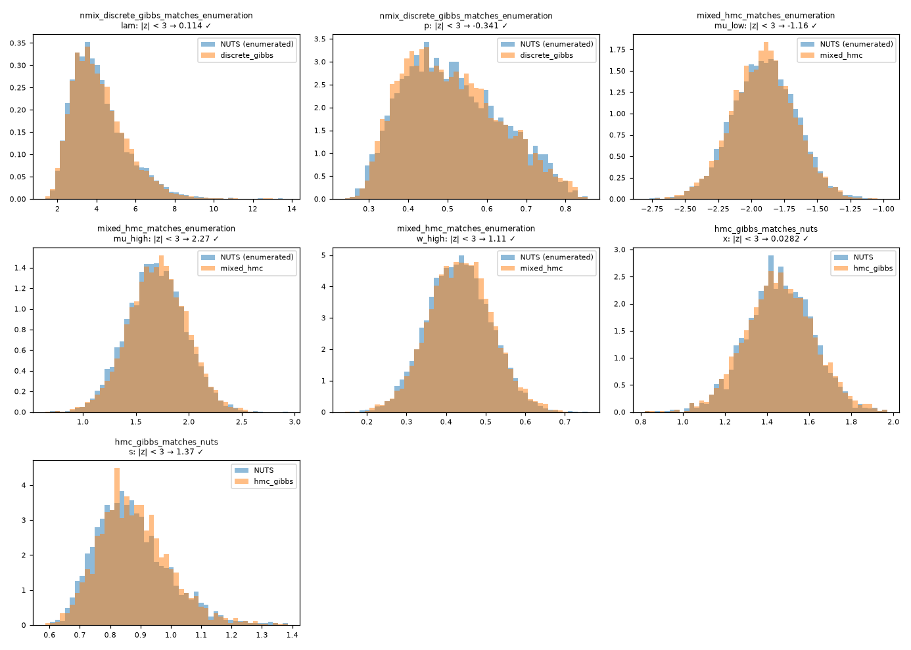

# Verification checks

| Test | Quantity | Reference | Criterion | Value | Result |
|---|---|---|---|---|---|
| `test_dpmm_latent_recovers_clusters` | mean ARI vs simulated clusters | simulated labels | > 0.9 | 0.991 | ✅ |

