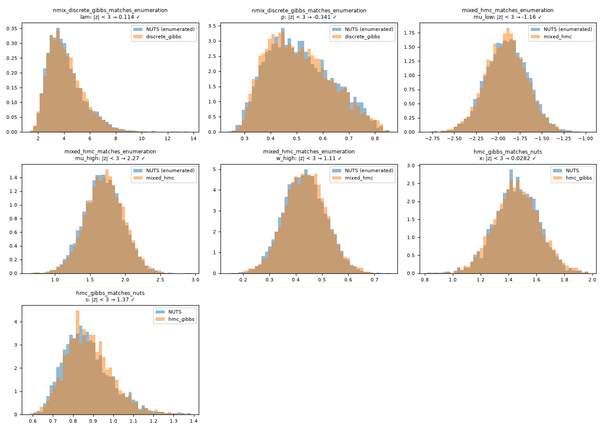

# Verification checks

| Test | Quantity | Reference | Criterion | Value | Result |
|---|---|---|---|---|---|
| `test_nmix_discrete_gibbs_matches_enumeration` | lam | NUTS + exact enumeration of N | |z| < 3 | 0.114 | ✅ |
| `test_nmix_discrete_gibbs_matches_enumeration` | p | NUTS + exact enumeration of N | |z| < 3 | -0.341 | ✅ |
| `test_dpmm_latent_recovers_clusters` | mean ARI vs simulated clusters | simulated labels | > 0.9 | 0.995 | ✅ |
| `test_mixed_hmc_matches_enumeration` | mu_low | NUTS + exact enumeration | |z| < 3 | -1.16 | ✅ |
| `test_mixed_hmc_matches_enumeration` | mu_high | NUTS + exact enumeration | |z| < 3 | 2.27 | ✅ |
| `test_mixed_hmc_matches_enumeration` | w_high | NUTS + exact enumeration | |z| < 3 | 1.11 | ✅ |
| `test_hmc_gibbs_matches_nuts` | x | plain NUTS | |z| < 3 | 0.0282 | ✅ |
| `test_hmc_gibbs_matches_nuts` | s | plain NUTS | |z| < 3 | 1.37 | ✅ |

