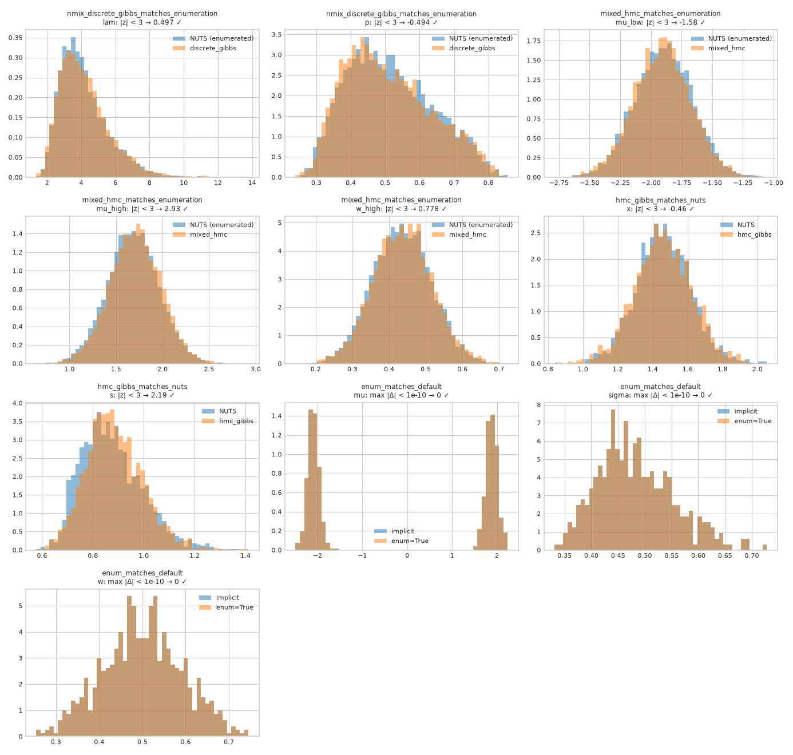
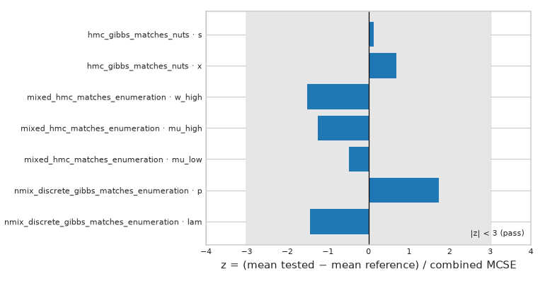

# Verification checks

| Test | Quantity | Reference | Criterion | Value | Result |
|---|---|---|---|---|---|
| `test_nmix_discrete_gibbs_matches_enumeration` | lam | NUTS + exact enumeration of N | |z| < 3 | -1.44 | ✅ |
| `test_nmix_discrete_gibbs_matches_enumeration` | p | NUTS + exact enumeration of N | |z| < 3 | 1.74 | ✅ |
| `test_dpmm_latent_recovers_clusters` | mean ARI vs simulated clusters | simulated labels | > 0.9 | 0.996 | ✅ |
| `test_mixed_hmc_matches_enumeration` | mu_low | NUTS + exact enumeration | |z| < 3 | -0.486 | ✅ |
| `test_mixed_hmc_matches_enumeration` | mu_high | NUTS + exact enumeration | |z| < 3 | -1.25 | ✅ |
| `test_mixed_hmc_matches_enumeration` | w_high | NUTS + exact enumeration | |z| < 3 | -1.5 | ✅ |
| `test_hmc_gibbs_matches_nuts` | x | plain NUTS | |z| < 3 | 0.69 | ✅ |
| `test_hmc_gibbs_matches_nuts` | s | plain NUTS | |z| < 3 | 0.124 | ✅ |
| `test_enum_matches_default` | mu | NumPyro, other path (consistency lock) | max |Δ| < 1e-10 | 0 | ✅ |
| `test_enum_matches_default` | sigma | NumPyro, other path (consistency lock) | max |Δ| < 1e-10 | 0 | ✅ |
| `test_enum_matches_default` | w | NumPyro, other path (consistency lock) | max |Δ| < 1e-10 | 0 | ✅ |
| `test_enum_is_exact_enumeration` | mu | infer={"enumerate": "parallel"} | max |Δ| = 0 | 0 | ✅ |
| `test_enum_is_exact_enumeration` | sigma | infer={"enumerate": "parallel"} | max |Δ| = 0 | 0 | ✅ |
| `test_enum_is_exact_enumeration` | w | infer={"enumerate": "parallel"} | max |Δ| = 0 | 0 | ✅ |
| `test_r_matches_python` | R: rows differing from Python (sim, rep, N, b, seed, result) | Python run_simulations, serial | == 0 | 0 | ✅ |

